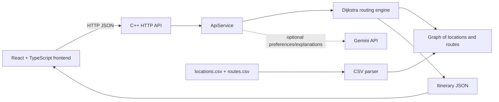

## Built With

<p>
 

</p>

## Specifications

- Optimized travel route plan
- Interactive route visualisation with Leaflet and OpenStreetMap
- Uses Graph data structure
- Via flight
- Fastest or cheapest preference

## Implementation

- CMake build system used
- Takes two countries as an input
- Generates structured JSON route data
- Data for routes and cities are taken through .csv file
- Graph holds location as nodes and routes as edges
- Dijkstra's algorithm determines the shortest path between the origin and destination

## Build

### Prerequisites

- C++11 compiler with MinGW or MSVC
- CMake 3.15 or newer
- Node.js 18 or newer and npm

### Clean setup

Clone the repository and build the native targets:

```powershell
git clone https://github.com/evasabeeh/travel-route-planner.git
cd travel-route-planner
cmake -S . -B build -DCMAKE_BUILD_TYPE=Release
cmake --build build --config Release
ctest --test-dir build --output-on-failure -C Release
```

Install and run the frontend in a second terminal:

```powershell
cd frontend
npm install
npm run dev
```

To run the local API, start it from the repository root before opening the
frontend:

```powershell
mingw32-make -f travel.make api
.\travel_api.exe
```

The API listens on `http://localhost:8080`. To enable optional Gemini
features, set `GEMINI_API_KEY` in the API server environment. Keep the key
server-side and never use a `VITE_*` variable for it.

Configure and build with CMake:

`cmake -S . -B build -DCMAKE_BUILD_TYPE=Release`

`cmake --build build --config Release`

For a debug build, use `-DCMAKE_BUILD_TYPE=Debug` and build with the
corresponding configuration.

Run the automated tests with:

`ctest --test-dir build --output-on-failure -C Release`

## Usage

Run:

`travel.exe <output.json> <origin-country> <destination-country> <fastest|cheapest>`

The program reports invalid countries, malformed input files, and unreachable
destinations without generating a route. Run the executable from the project
directory so it can find `locations.csv` and `routes.csv`.

## Architecture

- `domain/` contains locations, routes, and route results.
- `routing/` contains the graph, scoring policy, and Dijkstra algorithm.
- `data/` loads validated CSV data into a graph.
- `cli/` contains command-line orchestration in `cli/Main.cpp`.

The routing layer returns a `PathResult` and has no dependency on command-line
input or HTML generation, so it can be reused by another frontend or API.



## Route data contract

Successful routing returns a `PathResult` containing an `Itinerary`:

```json
{
  "origin": "India",
  "destination": "Japan",
  "totalCost": 1520,
  "totalDuration": 42,
  "transfers": 3,
  "segments": [
    {
      "origin": "India",
      "destination": "Japan",
      "transport": "plane",
      "cost": 1520,
      "duration": 42
    }
  ]
}
```

The C++ contract is represented by `Itinerary`, `RouteSegment`,
`CostDuration`, and `TransportType` in `domain/`. Failed requests return an
`ErrorResponse` with a stable `code` and human-readable `message`.

## API layer

`api/ApiService.h` provides HTTP-shaped request and JSON response handling:

- `GET /locations`
- `POST /routes/search`
- `GET /routes/{id}`
- `POST /preferences/parse` (optional Gemini-powered preference extraction)
- `POST /routes/explain` (optional Gemini-powered explanation of a deterministic itinerary)

Example search request:

```json
{
  "origin": "India",
  "destination": "Japan",
  "preference": "cheapest",
  "transportTypes": ["plane", "train"],
  "maximumTransfers": 3
}
```

`ApiService::handle` is transport-neutral, so it can be connected to any HTTP
server library or web framework. API tests run with `mingw32-make -f travel.make test`.

### API endpoints

| Method | Endpoint | Purpose |
| --- | --- | --- |
| GET | `/locations` | Return supported countries, capitals, and coordinates. |
| POST | `/routes/search` | Calculate a fastest or cheapest itinerary with filters. |
| GET | `/routes/{id}` | Return details for a stored route. |
| POST | `/preferences/parse` | Extract and validate search preferences with Gemini. |
| POST | `/routes/explain` | Explain an already-calculated itinerary with Gemini. |

An HTTP adapter should pass the incoming method, path, and body into
`ApiService::handle`, then return `ApiResponse.status`, `body`, and
`contentType`. This keeps HTTP framework code outside the routing engine.

Run the local HTTP API with:

```text
mingw32-make -f travel.make api
.\travel_api.exe
```

It listens at `http://localhost:8080`. The frontend defaults to this address,
so start the API before running `npm run dev`. Set
`VITE_API_BASE_URL` only when using a different API address.

## Frontend

The React/Vite frontend lives in [frontend/](./frontend). Install and run it
with:

```text
cd frontend
npm install
npm run dev
```

Set `VITE_API_BASE_URL` when the HTTP API is running on a different address.
The UI expects the API response for locations and routes so it never displays
substitute route data.

Run frontend tests and generate a local coverage report with:

```text
npm test
npm run test:coverage
npm run analyze
```

The generated `coverage/` and `test-results/` directories are local artifacts
and are intentionally excluded from version control. `npm run analyze`
generates the ignored `stats.html` bundle treemap and the production build
splits the results page and interactive globe into lazy-loaded chunks.

AI features are optional. Configure `GEMINI_API_KEY` in the API server's
environment (never in a `VITE_*` frontend variable). AI extracts validated
search preferences and explains an already-calculated itinerary; Dijkstra
remains authoritative for route selection. Without the key, manual search
continues to work and AI requests return an explicit error.